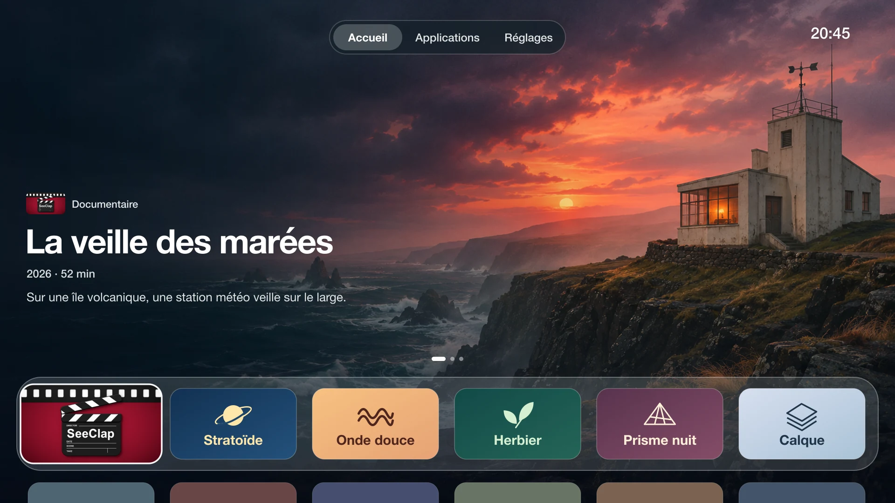

# SeeClap Launcher for Android TV

[Français](docs/guide/fr.md) · [English](docs/guide/en.md) · [Deutsch](docs/guide/de.md) · [Español](docs/guide/es.md) · [Italiano](docs/guide/it.md) · [Nederlands](docs/guide/nl.md) · [Português](docs/guide/pt.md) · [Русский](docs/guide/ru.md) · [Svenska](docs/guide/sv.md) · [Türkçe](docs/guide/tr.md) · [简体中文](docs/guide/zh.md) · [हिन्दी](docs/guide/hi.md)

Bring your favorite apps together on Android TV or Google TV (Android 7 or later). SeeClap stays in the first tile.



*Home screen illustration. The program and all apps except SeeClap are fictional.*

## 1. Clean up my TV with an assistant · Recommended

On a computer using the same Wi-Fi as your TV, open Claude Code or Codex with terminal access. Paste this message.

```text
Follow https://raw.githubusercontent.com/SeeAppsStudio/seeclap-launcher-android-tv/main/skills/seeclap-tv/SKILL.md
to guide me through clearing my TV’s app caches and offer to install SeeClap Launcher.
```

The assistant runs the commands and shows how much space was freed. You use the remote to approve the connection. Your apps and sign-ins stay in place. You choose whether to install the launcher or turn off any apps.

## 2. Install just the launcher · No AI needed

[Download SeeClap Launcher 1.0.0 for Android TV (signed APK)](https://github.com/SeeAppsStudio/seeclap-launcher-android-tv/releases/download/v1.0.0/seeclap-launcher-2.apk). Copy it to a USB drive, open it on the TV with a file manager, then select **Install**. If Android asks for installation permission, turn it off again afterward. Open **SeeClap Launcher** and follow the on-screen setup. [Step-by-step guide](docs/guide/en.md)

[Detailed help](docs/reference/en.md) · [Personal-use licence](LICENSE) · [Build from source](docs/build.md)

The computer-assisted setup is inspired by CleanYourTV. Parts of the remote and Home-button handling are adapted from that project. [CleanYourTV](https://github.com/Gathin23/cleanyourtv) · [Credits and licences](THIRD_PARTY_NOTICES.md)
